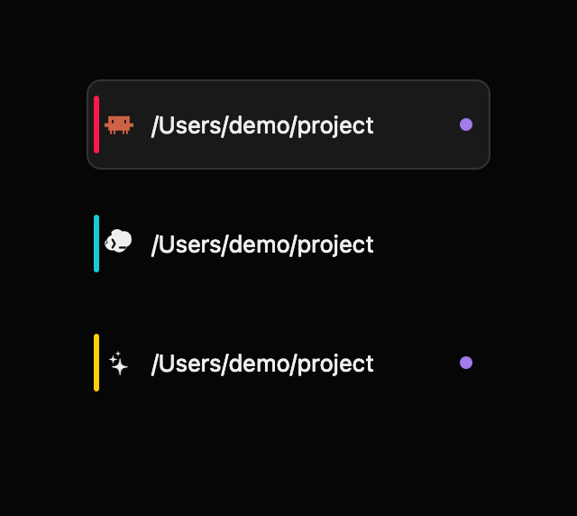
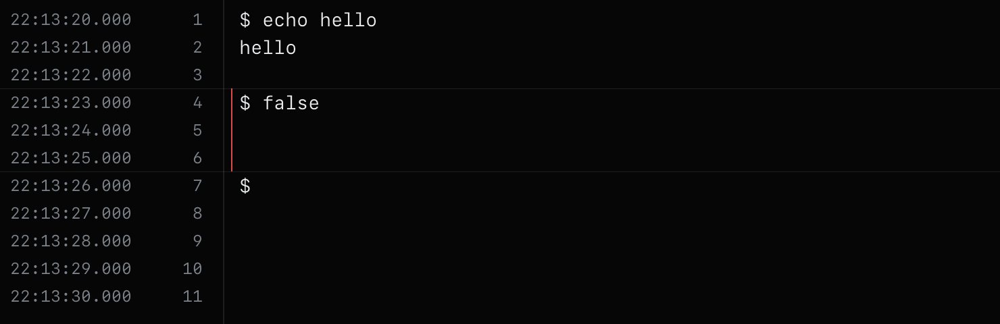
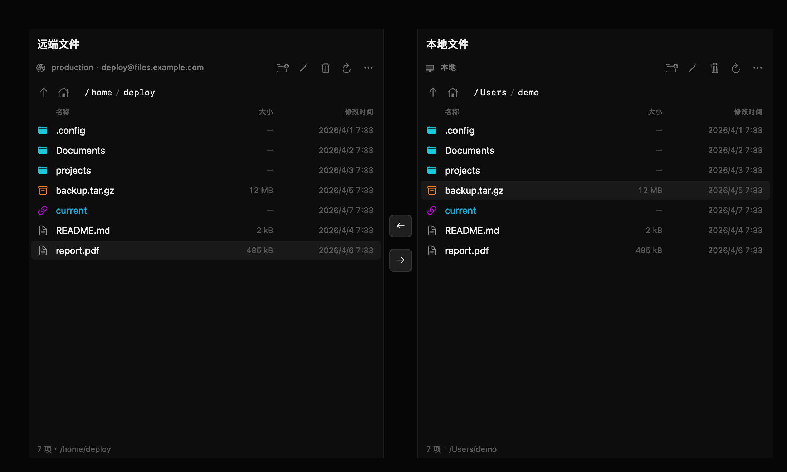
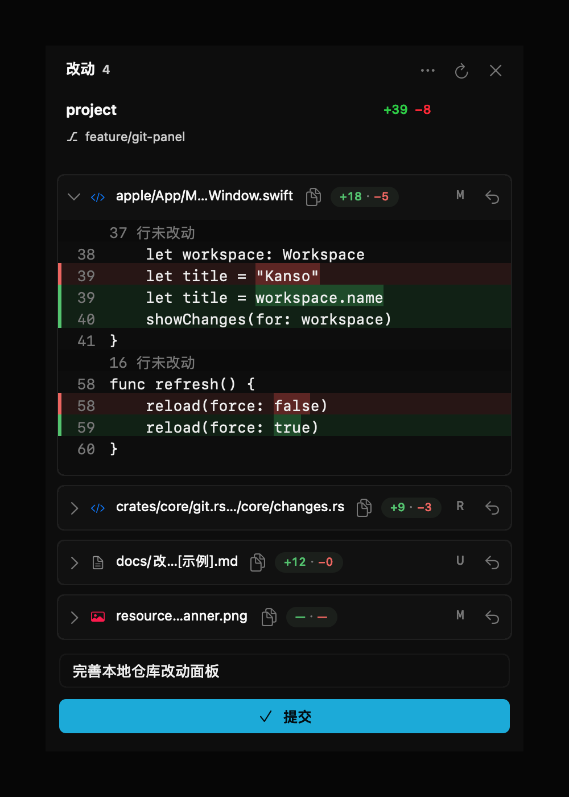
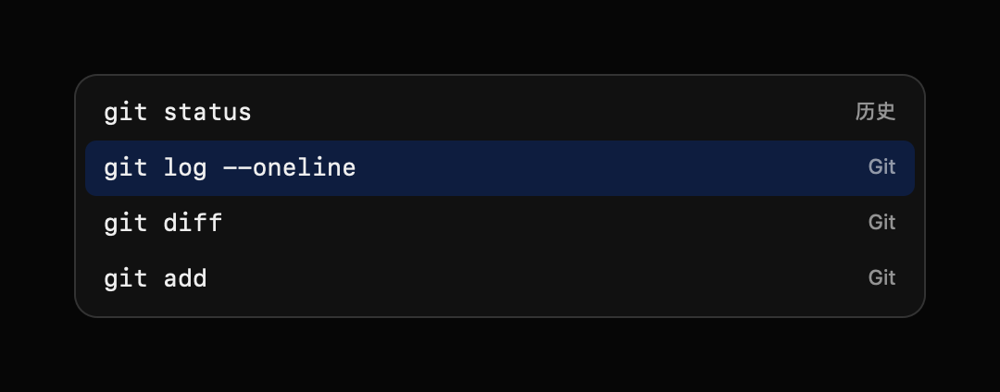
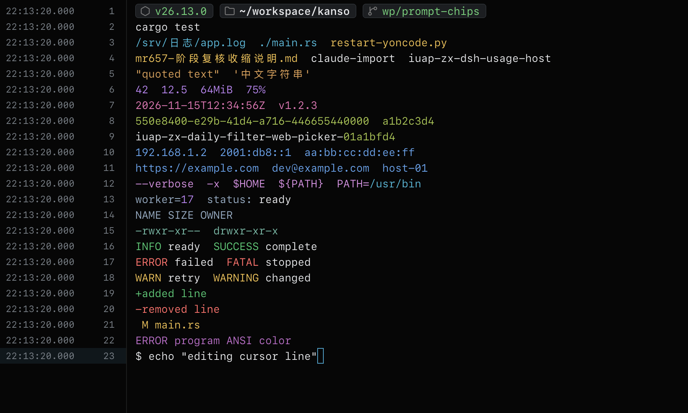

# Kanso

[简体中文](README.zh-CN.md)

**A native macOS terminal built for SSH work and AI coding agents.**
Local shells, SSH with jump hosts, an SFTP file browser, a Git changes panel and a command sender — in one fast, quiet window. No Electron, no web view, no telemetry.

## Why Kanso

- **Truly native and light.** Swift/AppKit UI with a Metal renderer and a Rust core. About an 11 MB download, a usable prompt in roughly 0.3 s and around 50 MB of memory at idle (measured on Apple Silicon).
- **Knows when an AI agent is running.** Tabs recognize Claude Code, Codex, Gemini CLI, Cursor Agent, Copilot CLI, Amp, OpenCode, Goose, Qwen Code, OpenHands, Grok and more — showing the tool's icon, whether it is working, and when it has finished in a background tab.
- **SSH and files in the same window.** Open the SFTP browser next to any SSH session, drag files in and out of Finder, or edit a remote file in your local editor and have it saved back automatically.
- **Output you can work with.** Every command becomes a block with its exit status and duration; copy the command, the output or both with one click, and jump between blocks with ⌘↑ / ⌘↓.
- **Built for real servers.** Jump-host chains, host-key change warnings, keyboard-interactive / MFA logins, ssh-agent, legacy-algorithm hosts, GBK / Shift-JIS encodings, and `rz` / `sz` (ZMODEM) transfers inside the terminal.

## Highlights

### AI-agent aware tabs



Kanso detects AI command-line tools running in a tab and shows the tool's own icon. A dot marks a working agent; a background tab that finished gets a "done, unread" marker so you know where to look next. The timestamp gutter hides itself automatically while a full-screen agent UI is running.

### Command blocks



Each command, its output, exit code and duration form a block (via OSC 133; zsh integration is built in). Hover a block to copy the command, the output or everything; failed commands get a red bar in the margin.

### SFTP file browser, side by side



Browse local folders or the remote host of the current SSH session, transfer between two panes, drag to and from Finder, and resolve conflicts explicitly. Remote edit downloads a file, opens it in your editor and uploads it on save — and asks before overwriting if the server copy changed in the meantime.

### Git changes at a glance



The title bar shows `+added −deleted` for the repository of the current shell. Open the panel for per-file inline diffs with the changed part of each line highlighted, discard changes per file, or commit — without leaving the terminal.

### Completion that knows your tools



Suggestions from your command history, local paths, and built-in knowledge of `git`, `kubectl`, `docker`, `systemctl` and `journalctl`, including contexts and namespaces from your kubeconfig.

### Readable output



Optional semantic coloring highlights paths, file names, hashes, IPs, URLs and table headers in plain command output. An optional gutter shows timestamps and line numbers for every line.

### And also

- **Sender** — send saved commands or multi-line snippets to the current tab or all tabs, once or on a repeating schedule.
- **Command palette** and a **session launcher** with groups, search and OpenSSH `~/.ssh/config` import.
- **Scrollback search** with regex and case-sensitive options.
- Tabs and split panes, light and dark themes with a minimum-contrast guard, rebindable shortcuts, English and Simplified Chinese.

## Install

Requires **macOS 14 or later** on an **Apple Silicon** Mac.

Download `Kanso-<version>-macOS-arm64.dmg` from [Releases](https://github.com/chhuax/Kanso/releases), open it and drag Kanso into Applications.

The app is ad-hoc signed and **not notarized** yet. On first launch, right-click Kanso and choose **Open**. If macOS still refuses:

```sh
xattr -dr com.apple.quarantine /Applications/Kanso.app
```

**Coming from Kanso 0.x?** Export your sessions from the old app (`.kanso` file) and import them here.

## Build from source

Install Xcode 16 or later, [rustup](https://rustup.rs/) and XcodeGen. Rust **1.94.1** and the `aarch64-apple-darwin` target are pinned in `rust-toolchain.toml` and installed automatically.

```sh
brew install xcodegen
cargo xtask apple-build --channel direct              # Debug build
cargo xtask dmg                                       # Release build + dmg in target/dist/
cargo install cargo-deny --locked && cargo xtask ci   # all checks, builds and tests
```

The Debug app is at `target/apple/DerivedData.noindex/Build/Products/Debug-Direct/Kanso.app`. Run `cargo xtask notices` after dependency changes to regenerate [THIRD_PARTY_NOTICES.md](THIRD_PARTY_NOTICES.md). More details: [docs/apple-build.md](docs/apple-build.md).

## Roadmap

- Linux and Windows versions, using GPUI and the same Rust core. Until then, Windows and Linux users can keep using the 0.x releases of [chhuax/Kanso-legacy](https://github.com/chhuax/Kanso-legacy).
- Notarized builds.

This repository is an independent rewrite and shares no code with Kanso-legacy, the earlier Tauri app based on EdgeTerm.

## Privacy

Kanso collects no telemetry and contains no analytics or usage-reporting code. It connects only to the hosts you configure. AI command-line tools run as separate programs under their own privacy policies.

## License

Copyright (c) chhuax. Source code is licensed under **GPL-3.0-or-later** — see [LICENSE](LICENSE). The Kanso name and application icon are not covered by the GPL grant. Third-party code and tool icons keep their own licenses and trademarks — see [THIRD_PARTY_NOTICES.md](THIRD_PARTY_NOTICES.md) and [asset provenance](docs/assets-provenance.md).
