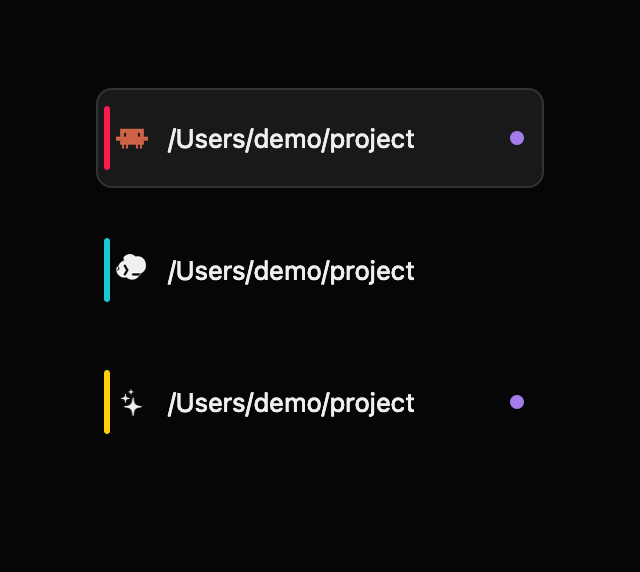
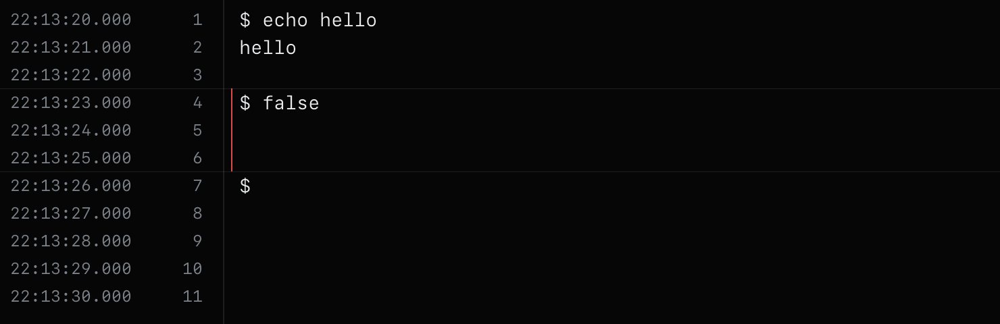
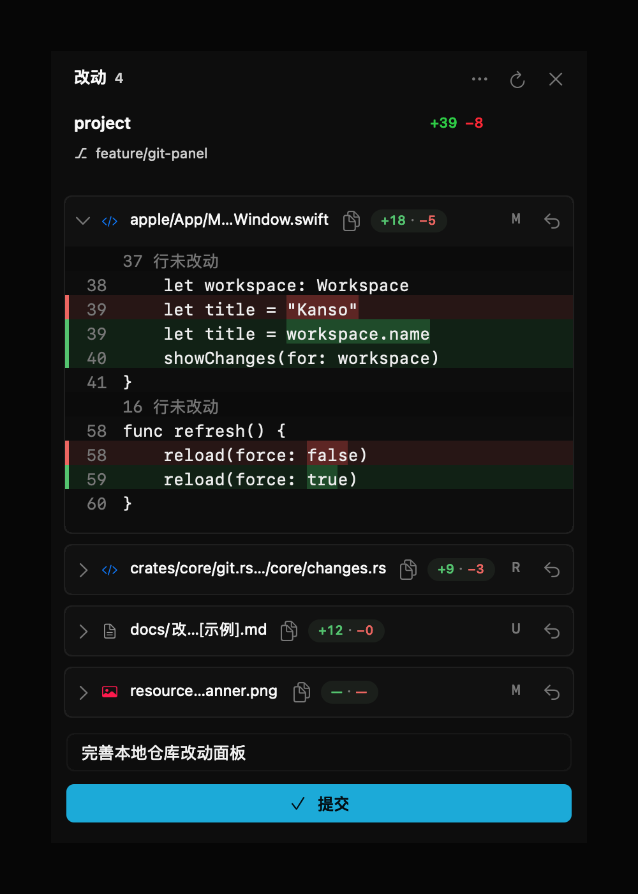
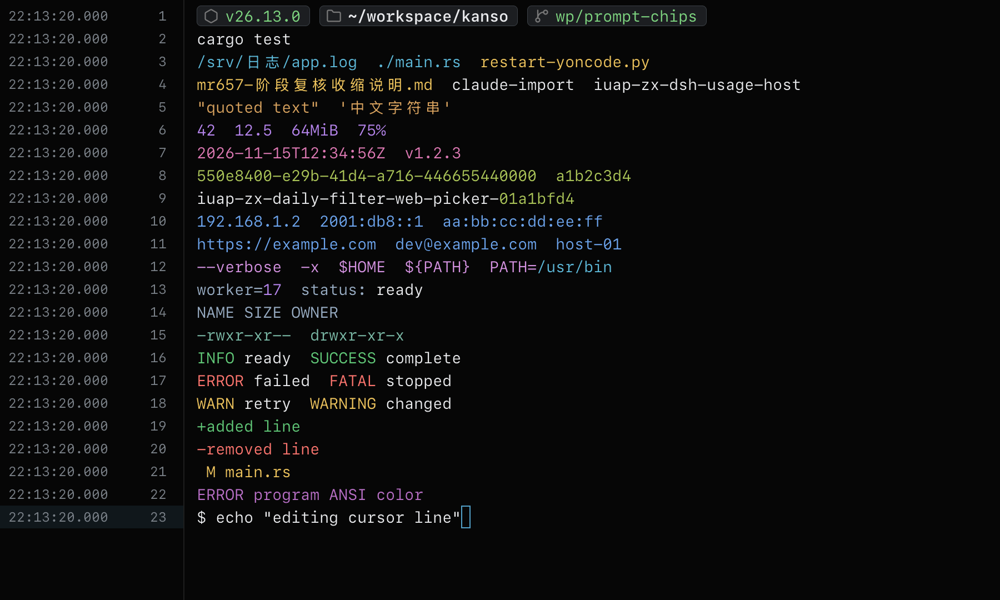

# Kanso

[English](README.md)

**为 SSH 运维和 AI 编程工具打造的 macOS 原生终端。**
本地 shell、带跳板机的 SSH、SFTP 文件浏览器、Git 改动面板、命令发送面板，都在一个又快又安静的窗口里。不用 Electron，不用网页视图，不收集任何数据。

## 为什么选 Kanso

- **真正原生、轻快。** 界面用 Swift/AppKit 和 Metal 渲染，核心用 Rust。安装包约 11 MB，启动到可输入约 0.3 秒，空闲内存约 50 MB（Apple 芯片实测）。
- **知道 AI 工具在跑。** 标签能识别 Claude Code、Codex、Gemini CLI、Cursor Agent、Copilot CLI、Amp、OpenCode、Goose、Qwen Code、OpenHands、Grok 等，显示工具自己的图标、是否在运行，后台标签跑完了也会提示你。
- **SSH 和文件在同一个窗口。** 任意 SSH 会话旁边直接打开 SFTP 文件浏览器，和访达互相拖放文件；远程文件用本地编辑器打开，保存后自动传回服务器。
- **输出可以直接拿来用。** 每条命令自成一块，带退出码和耗时；一键复制命令、输出或全部，⌘↑ / ⌘↓ 在命令之间跳转。
- **为真实服务器准备。** 多级跳板机、主机密钥变更提醒、键盘交互 / 多因素登录、ssh-agent、只支持旧算法的老服务器、GBK / Shift-JIS 编码，以及终端里直接 `rz` / `sz`（ZMODEM）传文件。

## 亮点

### 认得出 AI 工具的标签



标签里运行 AI 命令行工具时，图标换成该工具自己的标识；运行中有小圆点，后台标签跑完后会标记"已完成未查看"，一眼知道该看哪个。全屏的 AI 界面运行时，时间戳栏自动隐藏。

### 命令分块



每条命令连同输出、退出码、耗时组成一个块（基于 OSC 133，自带 zsh 集成）。鼠标移上去可以复制命令、复制输出或全部复制；失败的命令左侧有红色竖条。

### 双栏 SFTP 文件浏览器


浏览本机目录或当前 SSH 会话所在的远程主机，两栏之间互传，与访达互相拖放，冲突时明确让你选择。远程编辑：下载文件、用你的编辑器打开、保存时自动上传；如果服务器上的文件期间被改过，会先问你再覆盖。

### Git 改动一目了然



标题栏显示当前 shell 所在仓库的 `+新增 −删除` 行数。打开面板看每个文件的内联差异，行内改动部分单独高亮；可以逐个文件撤销改动，也可以直接提交，不用离开终端。

### 懂你常用工具的补全


候选来自命令历史、本地路径，以及内置的 `git`、`kubectl`、`docker`、`systemctl`、`journalctl` 常用写法，kubeconfig 里的上下文和命名空间也能补全。

### 更好读的输出



可选的语义着色会在普通命令输出里标出路径、文件名、哈希、IP、URL 和表头。可选的时间栏为每一行显示时间戳和行号。

### 其他

- **命令发送面板**：把保存的命令或多行片段发到当前标签或全部标签，可以只发一次，也可以定时重复。
- **命令面板**和**会话启动器**：支持分组、搜索，可导入 OpenSSH 的 `~/.ssh/config`。
- **回滚搜索**：支持正则和区分大小写。
- 标签与分屏，深浅色主题并保证最低对比度，快捷键可改，中英文界面。

## 安装

需要 **macOS 14 或更高版本**，**Apple 芯片**的 Mac。

从 [Releases](https://github.com/chhuax/Kanso/releases) 下载 `Kanso-<版本>-macOS-arm64.dmg`，打开后把 Kanso 拖进"应用程序"。

目前还**没有经过苹果公证**。第一次打开时，右键点 Kanso 选"打开"；如果仍被拦截：

```sh
xattr -dr com.apple.quarantine /Applications/Kanso.app
```

**从 Kanso 0.x 迁移？** 在旧版里导出会话（`.kanso` 文件），再在新版里导入即可。

## 从源码构建

安装 Xcode 16 或更高版本、[rustup](https://rustup.rs/) 和 XcodeGen。Rust **1.94.1** 和 `aarch64-apple-darwin` 目标已在 `rust-toolchain.toml` 中固定，会自动安装。

```sh
brew install xcodegen
cargo xtask apple-build --channel direct              # Debug 构建
cargo xtask dmg                                       # Release 构建并在 target/dist/ 生成 dmg
cargo install cargo-deny --locked && cargo xtask ci   # 全部检查、构建与测试
```

Debug 版在 `target/apple/DerivedData.noindex/Build/Products/Debug-Direct/Kanso.app`。依赖变化后运行 `cargo xtask notices` 重新生成 [THIRD_PARTY_NOTICES.md](THIRD_PARTY_NOTICES.md)。更多细节见 [docs/apple-build.md](docs/apple-build.md)。

## 路线图

- Linux 和 Windows 版：基于 GPUI，共用同一个 Rust 核心。在那之前，Windows 和 Linux 用户请继续使用 [chhuax/Kanso-legacy](https://github.com/chhuax/Kanso-legacy) 的 0.x 版本。
- 经过苹果公证的安装包。

本仓库是独立重写，与基于 EdgeTerm 的旧版 Tauri 应用 Kanso-legacy 不共享任何代码。

## 隐私

Kanso 不收集任何遥测数据，没有统计或使用上报代码，只连接你自己配置的主机。AI 命令行工具是独立运行的程序，遵循它们各自的隐私政策。

## 许可证

版权归 chhuax。源码以 **GPL-3.0-or-later** 授权，见 [LICENSE](LICENSE)。Kanso 名称和应用图标不在 GPL 授权范围内。第三方代码和工具图标保留各自的许可证与商标，见 [THIRD_PARTY_NOTICES.md](THIRD_PARTY_NOTICES.md) 和[素材来源登记](docs/assets-provenance.md)。
