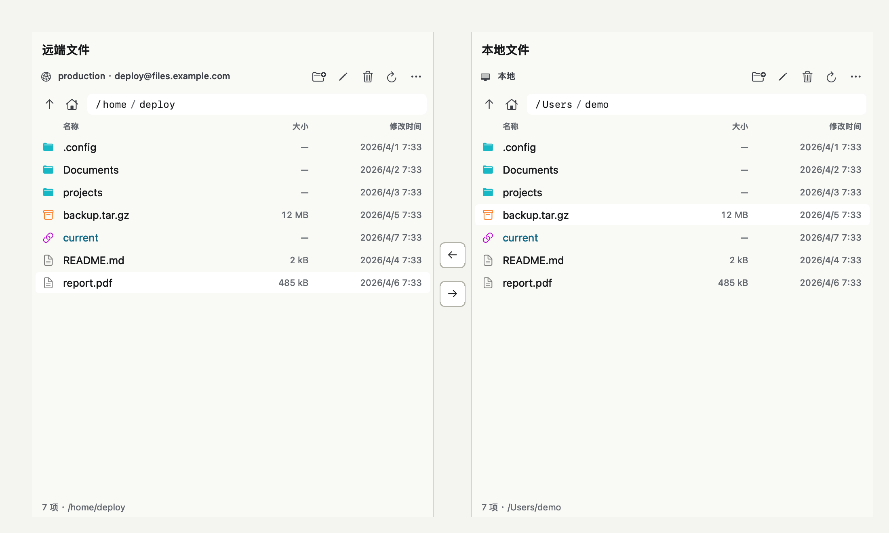

# Kanso

[English](README.md)

Kanso 是面向本地 shell 和 SSH 的 macOS 原生终端，内置 SFTP 文件浏览器、AI CLI 识别标签和命令块。界面使用 Swift/AppKit 和 Metal，核心使用 Rust。

## 功能

- 本地 shell 与 SSH 连接，支持密钥、密码、ssh-agent 和跳板机认证。
- 标签、分屏、保存会话和导入 OpenSSH 配置。
- 本地与 SFTP 文件浏览、上传下载，以及双栏文件传输视图。
- 为可识别的 AI 命令行工具显示标签图标和状态。
- shell 提供 OSC 133 标记时显示命令块、退出状态、耗时和复制操作；内置本地 zsh 集成。
- 终端搜索、命令历史与补全、保存命令的 Sender 面板，以及本地会话的 Git 变更面板。
- 深浅色外观、中英文和可配置快捷键。

## 截图

以下为 UI 截图测试的参考图片，使用示例数据。




## 安装

需要 **macOS 14 或更新版本**和 **Apple 芯片** Mac。当前构建不支持 Intel Mac。

从 [Releases](https://github.com/chhuax/Kanso/releases) 下载 `Kanso-<版本>-macOS-arm64.dmg`，打开后将 Kanso 拖入 Applications。

应用使用临时签名，**未经公证**。首次打开时，右键点击 Kanso，选择“打开”。如果 macOS 仍拦截你信任的下载，可移除隔离属性：

```sh
xattr -dr com.apple.quarantine /Applications/Kanso.app
```

## 从源码构建

安装支持 Swift 6 的 Xcode（16 或更新版本），将其选为当前开发者目录，并安装 [rustup](https://rustup.rs/) 和 XcodeGen。仓库通过 `rust-toolchain.toml` 固定 Rust **1.94.1**、rustfmt、clippy 及 `aarch64-apple-darwin` 目标；在仓库中运行 Cargo 时，rustup 会安装它们。

```sh
brew install xcodegen
cargo xtask apple-build --channel direct
```

Debug 应用位于 `target/apple/DerivedData.noindex/Build/Products/Debug-Direct/Kanso.app`。

```sh
cargo xtask apple-build --channel direct --configuration release
cargo xtask dmg
```

`dmg` 构建 Release Direct 应用，生成 `target/dist/Kanso-1.0.0-macOS-arm64.dmg`，并输出 SHA-256。沿用现有临时签名，不做公证。

执行包含 Apple 构建和测试的全部检查：

```sh
cargo install cargo-deny --locked
cargo xtask ci
```

依赖变化后运行 `cargo xtask notices`，重新生成 [THIRD_PARTY_NOTICES.md](THIRD_PARTY_NOTICES.md)。更多构建说明见 [docs/apple-build.md](docs/apple-build.md)。

## 路线图与旧版

Linux 和 Windows 版计划基于 GPUI 实现，目前尚未提供。当前 Windows/Linux 用户请使用 [chhuax/Kanso-legacy](https://github.com/chhuax/Kanso-legacy) 的 **0.x** 版本。

本仓库是独立重写，与基于 EdgeTerm 的旧版 Tauri 应用 Kanso-legacy 不共享代码。

## 隐私

Kanso 不收集遥测，不含分析 SDK 或使用情况上报服务。SSH/SFTP 连接到你配置的主机；AI 命令行工具是独立程序，适用各自的隐私政策。

## 许可证

版权归 chhuax。源码以 **GPL-3.0-or-later** 授权，见 [LICENSE](LICENSE)。Kanso 名称和应用图标不在 GPL 授权范围内。第三方代码和工具图标保留各自的许可证及商标，见 [THIRD_PARTY_NOTICES.md](THIRD_PARTY_NOTICES.md) 和[素材来源登记](docs/assets-provenance.md)。
